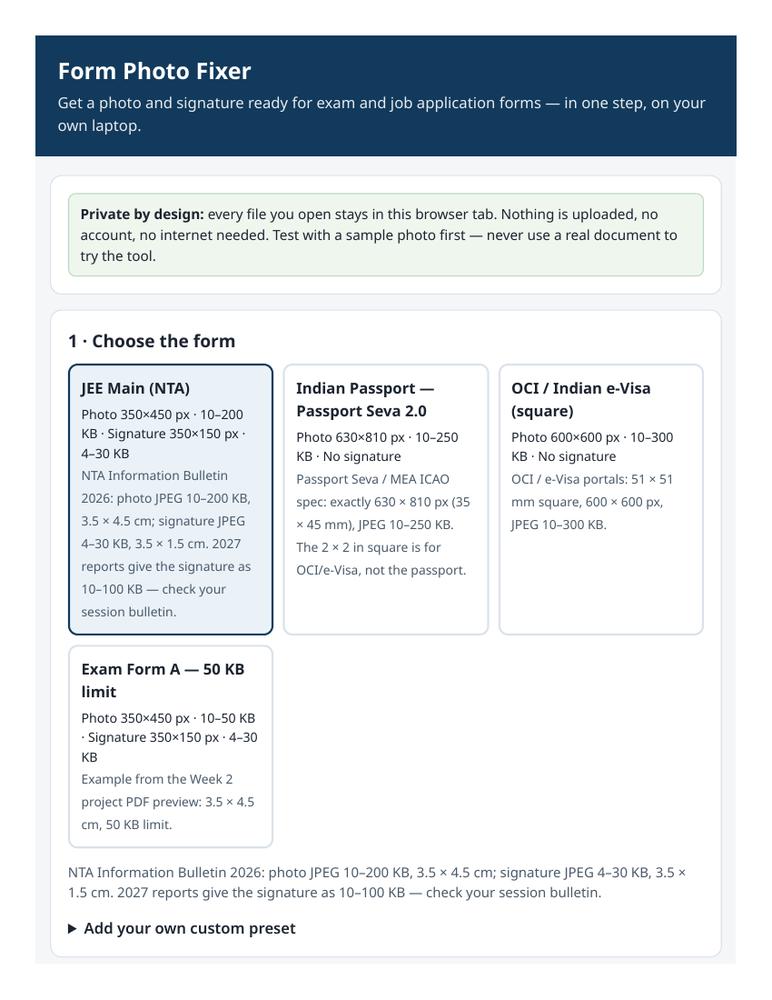
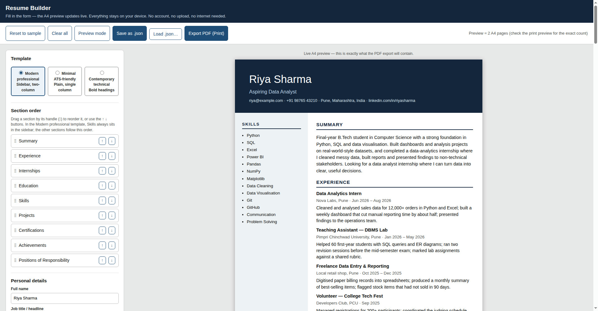

# BSERC Week 2 — Section A: Web Tools

Two offline-first web applications developed as part of the **Bharat Space Education Research Centre (BSERC) GenAI Internship — Week 2** (15-day GenAI Internship 2026, instructor Karan Bagul).

> **This is an independently developed student project** created by Meet Patil as part of the BSERC GenAI Internship. **BSERC does not officially endorse this repository**, and nothing in it is an official BSERC publication.

## Project overview

Week 2 of the internship is about building apps, tools and extensions with an AI agent. Section A ("Web tools") asks for at least two useful web applications that run in a browser, keep files on the user's own laptop, and need no account, no paid API and no internet connection.

This repository contains the two selected Section A projects:

1. **Form Photo Fixer** — prepares photographs and signatures for examination, university and job application forms (crop, resize and compress to each form's size and file-size rules).
2. **Resume Builder** — builds a clean A4 resume from a form, with a live preview, three genuinely different templates, rearrangeable sections and PDF export.

Both applications are single self-contained HTML files with inline CSS and JavaScript. They process everything locally in the browser: **no file is ever uploaded anywhere**.

## Project 1 — Form Photo Fixer

`form-photo-fixer/` — open `form-photo-fixer/index.html` in any browser.

Get a photo and signature ready for exam and job application forms in one step, on your own laptop.

- **Upload** — photo and signature (JPEG/JPG/PNG only). The original file's name, dimensions and size are shown as soon as it loads. Invalid files are rejected with a clear on-page error.
- **Form presets** — 4 presets with documented sources: JEE Main (NTA), Indian Passport (Passport Seva 2.0), OCI / Indian e-Visa, and the PDF's "Exam Form A" 50 KB example. Each preset defines the required pixel dimensions and the minimum–maximum file size. See `docs/official-form-references.md`.
- **Crop** — interactive crop workspace: drag to pan, zoom slider, crop-size slider, face-position guide (dashed oval), aspect ratio locked to the preset.
- **Compress** — JPEG quality is stepped down (from 92% in 4% steps) until the file sits just under the target KB, with live progress. The result shows the original crop and the processed image side by side, each labelled with dimensions and KB, plus quality used, size before → after, and KB saved.
- **Custom presets** — create your own preset (width, height, min/max KB, signature size). Custom presets are saved in the browser (localStorage) and can be deleted.
- **Download** — processed photo and signature as separate files with meaningful filenames (`photo-<preset>.jpg`, `signature-<preset>.jpg`), plus success/error toast notifications and a final ready/not-ready validation status.

A fake sample photo (`form-photo-fixer/public/sample-photo.jpg`, drawn locally, clearly labelled SAMPLE) and a built-in sample signature are included so the tool can be tested without a real photo.

## Project 2 — Resume Builder

`resume-builder/` — open `resume-builder/index.html` in any browser.

A free, offline-first resume builder: fill in a form and watch a clean A4 resume build itself.

- **Editor + live A4 preview** — two-panel layout: form on the left, A4 preview on the right, updating as you type. Sections: personal information, professional summary, experience, internships, education, skills, projects, certifications, achievements, positions of responsibility.
- **Three genuinely different templates** — exactly as specified: **Modern professional** (dark header, two-column layout with a sidebar), **Minimal ATS-friendly** (plain single column, no sidebar or graphics, deliberately plain so applicant tracking systems can parse it), **Contemporary technical** (large bold name, extra-bold uppercase headings, wide spacing).
- **Reorder sections** — drag and drop any of the 9 sections, or use ↑ / ↓ buttons (useful on a phone). The preview and the exported PDF both follow the chosen order.
- **Summary character counter** — live `n / 600 characters` count under the professional summary; it warns past 600 but never blocks typing or truncates text.
- **PDF export** — uses the browser's Print to PDF (`window.print()` with `@page A4` CSS), so the text in the PDF stays selectable and copyable. Headings are kept with their content across page breaks.
- **Save and load** — **Save as .json** downloads all resume data, the template choice and the section order; **Load .json…** restores everything. Work is also autosaved in the browser (localStorage). **Reset to sample** and **Clear all** both ask for confirmation first.
- **Preview mode** — hide the editor and see only the A4 preview (Esc exits). **Mobile editing** — on narrow screens the panels stack and the A4 sheet shrinks to the screen width.

A fake sample resume is preloaded (Riya Sharma, `riya@example.com` — the sample person from the Week 2 PDF preview) and is also provided as `resume-builder/public/sample-resume.json`, which loads directly into the app.

## Features (both apps)

- Run locally in a web browser; work with Wi-Fi off after opening the file.
- No account, no login, no paid API, no external service.
- All user data processed locally on the device; nothing uploaded.
- Responsive layouts for desktop and mobile.
- Realistic but fictional sample data throughout.
- Professional, modern interfaces; every button and control does something — no dummy buttons.

## Technology stack

- **HTML5, CSS3, JavaScript** — each app is one self-contained HTML file with inline CSS and JavaScript.
- **Browser-native APIs only** — Canvas and FileReader for image processing, `localStorage` for autosave/custom presets, `window.print()` for PDF export.
- **No backend, no build step, no package manager** — there is no `package.json` and no `node_modules`; nothing to install or compile.
- **No external libraries, fonts or assets** — system font stacks only, zero external references, so both apps work fully offline.
- **No external APIs** for image processing, resume generation or PDF export.

## Repository structure

```
bserc-week2-section-a-projects/
│
├── README.md                  # This file
├── prompts.md                 # Every development prompt, in chronological order
├── LICENSE                    # MIT licence (original code in this repo only)
│
├── form-photo-fixer/
│   ├── index.html             # The app — double-click to run
│   ├── README.md
│   ├── src/                   # index.html, README.md, prompts.md, test-checklist.md
│   └── public/
│       └── sample-photo.jpg   # Fake sample photo for testing (labelled SAMPLE)
│
├── resume-builder/
│   ├── index.html             # The app — double-click to run
│   ├── README.md
│   ├── src/                   # index.html, README.md, prompts.md, test-checklist.md
│   └── public/
│       └── sample-resume.json # Fake sample resume (Riya Sharma) — loads in the app
│
└── docs/
    ├── project-overview.md
    ├── form-photo-fixer-requirements.md
    ├── resume-builder-requirements.md
    ├── testing-report.md
    ├── official-form-references.md
    └── screenshots/
        ├── form-photo-fixer.png
        └── resume-builder.png
```

## Installation and execution

There is nothing to install.

1. Clone or download this repository.
2. Open `form-photo-fixer/index.html` or `resume-builder/index.html` in any modern browser (Chrome / Edge / Firefox) — double-click works, or use File → Open.
3. That's it. No build step, no server, no `npm install`, no account.

To test offline: turn Wi-Fi off and reload the page — both apps still work, because neither file references anything outside itself.

Live demo: both apps are also deployed on Vercel (links in the Screenshots section below). The deployments update automatically whenever this repository changes, because each Vercel project builds from its app folder (`form-photo-fixer/` and `resume-builder/`).

Optional: serve the folder over a local static server (e.g. `python3 -m http.server`) if you prefer a URL to a file path; it is not required.

## Screenshots

Both screenshots below are genuine captures of the deployed apps running in a real browser (5 Nov 2026), using the fake sample data only — nothing staged or mocked up. Try them live: [Form Photo Fixer](https://form-photo-fixer-bserc-meet29.vercel.app/) · [Resume Builder](https://resume-builder-bserc-meet29.vercel.app/).

### Form Photo Fixer



### Resume Builder



## Testing and validation

Testing was done in this order: build → test in a headless harness → fix → re-test (at least three build-test-fix rounds per app). Full detail is in `docs/testing-report.md` and in each app's `test-checklist.md`.

What was actually tested here (all with fake/sample data only):

- **Form Photo Fixer** — `node --check` passes on the extracted script; zero external references; a jsdom test harness ran **69/69 assertions** (uploads, validation, original-size display, crop resize, processing at all 4 presets with output px/KB inside each preset's min–max range, comparison view, custom-preset persistence and delete, signature flow, downloads) plus **11/11 edge-case assertions** (PNG output, invalid custom preset, toasts, reset). Three real failures were found and fixed during testing (negative "KB saved", a preset-matching bug in the harness, and a stale-image bug where the Process button stayed enabled after a failed upload).
- **Resume Builder** — `node --check` passes; zero external references; jsdom tests **42/42 assertions** across the upgrade rounds (new sections, save/clear/load round-trip including legacy template names, summary counter, confirm dialogs, preview mode, drag-and-drop reorder, template application, mobile CSS) plus 21/21 in the first build; WeasyPrint rendering of the JavaScript-built page gave **3 A4 pages in all three templates**, with all text extractable via `pdftotext` (selectable text, not images). The sample JSON in `public/` was verified to load into the app (12/13 jsdom checks passed outright; the 13th was a key-order-only difference in a string comparison — a deep-equal check confirmed the loaded data is identical).

### Honest gaps — what still needs the user's machine

No browser (Chrome/Firefox) is installed in the build environment, so these checks could **not** be done here and are **not** claimed as passed:

- **Form Photo Fixer:** upload a large phone photo (several MB) with Wi-Fi off, process it, and confirm the downloaded file's properties show the preset dimensions and a size inside the limit; confirm the face sits inside the oval in a real browser.
- **Resume Builder:** one real Chrome **Export PDF (Print to PDF)** check — page count in Chrome's print preview, and select/copy a line of text from the produced PDF; reload with Wi-Fi off; open the file on a real phone and confirm the mobile layout has no horizontal overflow.
- **Both apps:** the jsdom harnesses stub canvas decoding, so real-browser rendering is the final check.

These are listed as to-verify items in each app's `test-checklist.md`, not as passed tests.

### Known limitations

- Form Photo Fixer resizes and compresses only — it does not retouch photos, change backgrounds, or guarantee a form will accept the photo. If a processed file lands below a form's *minimum* KB, the app warns you.
- PNG output has no quality setting, so it may exceed a KB limit — JPEG is the recommended format.
- In Resume Builder, the Modern professional template always puts Skills in the sidebar by design; the other eight sections follow the dragged order. The PDF export prints the preview as-is — it does not shrink text to fit one page.
- Form rules change every cycle: always re-check the current official notice for your form before submitting. See `docs/official-form-references.md`.

## Privacy and offline-first approach

- Every file you open stays in your browser tab. Nothing is uploaded to any server — there is no server code in this repository and no network request in either app (verified by grep: zero external references).
- No account, no login, no tracking, no analytics.
- Test with the supplied fake sample data, not real documents — the Week 2 PDF rules say to test with fake or sample data, and both apps are built around that.
- Custom presets (Form Photo Fixer) and autosave (Resume Builder) live in the browser's localStorage on your own device; the portable copy is the downloaded file (photo/signature `.jpg`, resume `.json`).

## Learning outcomes

- Building genuinely useful offline-first web tools with plain HTML/CSS/JavaScript and browser-native APIs, without a backend or a framework.
- Image processing in the browser: Canvas-based cropping, aspect-ratio enforcement and stepwise JPEG quality reduction to hit a file-size target.
- Print CSS and A4 pagination: `@page`, page-break rules and Print-to-PDF export that keeps text selectable.
- Requirements traceability: every mandatory feature from the brief mapped to an implementation and a test (see `docs/`).
- Honest testing: headless test harnesses, build-test-fix rounds, and clearly separating what was verified here from what still needs a real browser or phone.
- AI-assisted development done properly: keeping every prompt in order in `prompts.md`, and not claiming a feature works unless it has been tested.

## Future improvements

- Form Photo Fixer: more form presets as official notices are checked; a background-colour check/warning; EXIF orientation handling for phone photos.
- Resume Builder: more templates; a one-page-fit option; import from LinkedIn-style data (only with the user's own export file, still fully offline).
- Both apps: end-to-end tests in a real browser (Playwright) once a browser is available in the build environment; the live deployments are already linked from the Screenshots section above.
- Packaging: a single ZIP of the two apps for the BSERC submission, alongside the Week 1 submission files.

## Licence

MIT — see `LICENSE`. The MIT licence covers the **original code in this repository only**. Third-party sources (official form notices, framework documentation) are **linked, not uploaded**, and are not covered by this licence.

---

*BSERC GenAI Internship — Week 2, Section A. Built with AI-assisted development (Muse + ChatGPT planning, Muse building), tested headlessly as documented above, with the real-browser checks listed under "Honest gaps" still to be done on the author's machine.*
